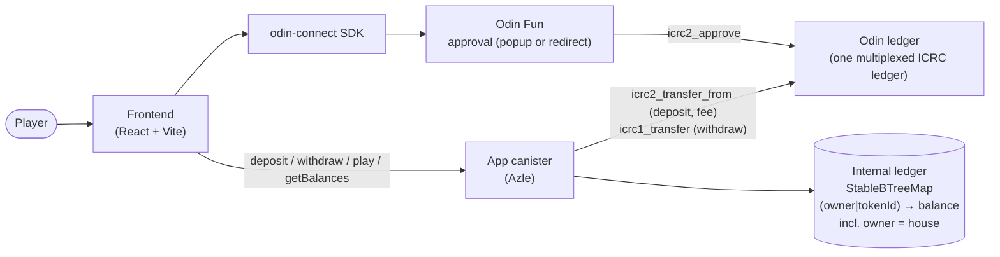

# plinko

Plinko game on **Odin Fun**: Odin Connect login, ICRC-2 deposit into an app
canister, bets resolved on-chain, withdraw back to Odin. Laid out after
[odin-app-template](https://github.com/Toniq-Labs/odin-app-template).

## Stack

- **Canister**: [Azle](https://github.com/demergent-labs/azle) 0.33 (TypeScript, Internet Computer)
- **Frontend**: React 19 + TypeScript + Vite 8, [odin-connect](https://www.npmjs.com/package/odin-connect) 2.x (state store)
- **Tooling**: dfx, pnpm workspace

## Architecture



**Deposit**: the player approves the app canister as an ICRC-2 spender through
the Odin approval page; once the approval result is in the odin-connect state,
the frontend calls `deposit` and the canister pulls the approved funds itself
(`icrc2_transfer_from`) and credits the player's internal balance. A credit is
only ever recorded for funds that actually settled.

**Play**: `play(token, bet, rows, risk)` debits the bet from the internal
balance, checks the house bankroll can cover the top payout, draws one random
bit per row from the canister's CSPRNG (seeded from the IC's `raw_rand`),
computes slot and payout with integer math, settles both the player and the
house, and returns the path. The frontend only animates that path; the landing
slot is the number of "right" steps. Multiplier tables live in
`packages/shared` and are the same source for the canister and the board
labels.

**Withdraw**: the player approves the BTC ledger fee; `withdraw` debits the
internal balance (persisted *before* the transfer await), pulls the fee, sends
the tokens back on the Odin ledger (`icrc1_transfer`), refunding the debit on
failure.

**House bankroll**: `fundHouse(token, amount)` is a permissionless deposit
into the `house` owner key. `getMaxBet` tells the frontend the largest bet the
bankroll covers; `play` enforces it. The deploying principal (`getOwner`) can
`withdrawHouse`.

## Layout

```
packages/
  shared/     # pure TS — multiplier tables (x100), path → slot, payout math
  canister/   # Azle canister — ledger, house bankroll, play
  frontend/   # Vite + React game — Odin Connect auth, deposit/withdraw, play
dfx.json      # canister (azle) + frontend (asset) canister config
```

## Prerequisites

- [Node.js](https://nodejs.org) 22+ (see `.nvmrc`)
- [pnpm](https://pnpm.io) 10+
- [dfx](https://internetcomputer.org/docs/current/developer-docs/getting-started/install) 0.31+
- [Rust](https://www.rust-lang.org/tools/install) + `wasm32-unknown-unknown` target (required by Azle)

```sh
rustup target add wasm32-unknown-unknown
```

## Quick start

```sh
pnpm install          # installs workspace deps + the azle dfx extension (if dfx is on PATH)
dfx start --clean --background
pnpm deploy:dev       # build + deploy the canister against the Odin dev ledger
dfx deploy frontend   # build + deploy the frontend asset canister
```

The canister takes the **Odin ledger** it holds funds on as a required init
argument (see [Odin ledger](#odin-ledger)). `pnpm deploy:dev` / `pnpm
deploy:prod` pass it for you; a bare `dfx deploy` prompts for it. The frontend
asset canister does not depend on the app canister in `dfx.json` (it gets the
canister id from `VITE_APP_CANISTER_ID`), so `dfx deploy frontend` never
redeploys the canister without its argument.

> If `pnpm install` ran before `dfx` was installed:
> `pnpm --filter @plinko/canister exec azle extension install`

Then point the frontend at the canister and start the dev server:

```sh
cp packages/frontend/.env.example packages/frontend/.env
# set VITE_APP_CANISTER_ID to CANISTER_ID_CANISTER_DEV from the root .env
# (or CANISTER_ID_CANISTER after `pnpm deploy:prod`) and VITE_ODIN_ENV to match
pnpm dev:frontend
```

Deposits, withdrawals and `fundHouse` talk to the mainnet Odin ledger, so on a
local replica only the read endpoints and the validation paths of `play` can
be exercised; the full flow needs `--network ic`.

## Scripts

| Command               | Description                              |
| --------------------- | ---------------------------------------- |
| `pnpm build`          | Frontend dist + `dfx build … --check` for both canisters |
| `pnpm build:canister` | Build the Azle canister (`canister` and `canister_dev`) |
| `pnpm build:frontend` | Build the frontend                       |
| `pnpm deploy:dev`     | Deploy `canister_dev` on the Odin dev ledger |
| `pnpm deploy:prod`    | Deploy `canister` on the Odin prod/staging ledger |
| `pnpm dev:frontend`   | Start the Vite dev server                |
| `pnpm typecheck`      | Type-check frontend + shared             |
| `pnpm test`           | Unit tests (tables, ledger core, ledger id, bet resolution) |

## Environment

`packages/frontend/.env` (see `.env.example`):

| Variable               | Purpose                                              |
| ---------------------- | ---------------------------------------------------- |
| `VITE_ODIN_APP_NAME`   | Name shown on the Odin approval page                 |
| `VITE_ODIN_ENV`        | `prod`, `staging`, `dev`, `local` or `legacy`; must match the canister's ledger (see [Odin ledger](#odin-ledger)) |
| `VITE_APP_CANISTER_ID` | App canister id (spender + actor target): `canister` for prod, `canister_dev` for dev |
| `VITE_GAME_TOKEN_ID`   | The one Odin token players deposit and bet with (`btc`) |
| `VITE_HOUSE_ADMINS`    | Odin principals shown the "Fund house" button (UI gate only) |
| `VITE_DFX_NETWORK`     | `local` (fetches the root key) or `ic`               |
| `VITE_IC_HOST`         | Optional replica/boundary host override              |

## Canister API

| Endpoint                 | Kind   | Description                                                            |
| ------------------------ | ------ | ---------------------------------------------------------------------- |
| `deposit(token, amount)` | update | Pull pre-approved funds from the Odin ledger and credit the caller.    |
| `withdraw(token, amount)`| update | Debit the caller and send tokens back via the Odin ledger.             |
| `play(token, bet, rows, risk)` | update | Resolve one bet; returns `{ path, slot, multiplier_x100, payout, balance }`. |
| `fundHouse(token, amount)` | update | Pull pre-approved funds into the house bankroll (permissionless).    |
| `withdrawHouse(token, amount)` | update | Owner-only: move bankroll to the owner.                          |
| `getBalance(token)`      | query  | Caller's internal balance for one token.                               |
| `getBalances()`          | query  | All of the caller's `(token, balance)` pairs.                          |
| `getHouseBalance(token)` / `getHouseBalances()` | query | House bankroll.                                   |
| `getMaxBet(token, rows, risk)` | query | Largest bet the bankroll covers for that table.                  |
| `getOwner()`             | query  | The deploying principal.                                               |
| `getOdinLedger()`        | update | The Odin ledger canister this canister holds funds on (certified).     |
| `icrc28_trusted_origins` | update | ICRC-28 trusted origins — the web origins allowed to request signed calls. |

> **ICRC-28 / Odin Connect auth:** `TRUSTED_ORIGINS` in
> [`packages/canister/src/index.ts`](packages/canister/src/index.ts) lists
> `http://localhost:5173`, `:5174` and the production origin
> `https://plinko-a86.netlify.app`. **Any new frontend origin must be added
> there and the canister redeployed** (bare `scheme://host[:port]`, exact
> match) or login fails. The endpoint must stay `update` so the signer gets a certified
> reply.

Tokens are identified by their **Odin token id** (text); every Odin token
shares one ledger and is addressed by subaccount (`odin_token_pointer`).
Balances are keyed by `(owner, tokenId)` in stable memory, so they survive
upgrades. `rows` is one of 8, 10, 12, 14, 16; `risk` is `low`, `medium` or
`high`. Bets and balances are base units (`bigint`).

### Odin ledger

Each Odin environment has its own ledger canister, and this repo deploys one
app canister per ledger from the same source:

| Environment    | `VITE_ODIN_ENV`   | Ledger canister               | dfx canister   | Deploy script      |
| -------------- | ----------------- | ----------------------------- | -------------- | ------------------ |
| dev            | `dev`             | `w5cxm-6iaaa-aaaaj-az4jq-cai` | `canister_dev` | `pnpm deploy:dev`  |
| prod / staging | `prod`, `staging` | `yspgd-ciaaa-aaaaj-a6rrq-cai` | `canister`     | `pnpm deploy:prod` |

The canister takes the ledger as its init argument,
`(record { ledger_id = principal "<ledger>" })`, and rejects any principal not
in the table above (`ODIN_LEDGER_IDS` in
[`odin_ledger.ts`](packages/canister/src/odin_ledger.ts)). The frontend's
`VITE_ODIN_ENV` **must match it** — otherwise users approve on one ledger while
the canister pulls from another, and deposits fail.

The ledger is **immutable after install**. Every internal balance (players and
house) is backed by tokens held on that ledger, so switching ledgers would let
withdrawals pay out funds that were never deposited there. On upgrade, pass the
same argument again (the deploy scripts do this); an upgrade naming a different
ledger traps and the old code keeps running. To change environment, reinstall
(`dfx deploy <name> --mode reinstall …`, which **wipes all balances** — only on
a canister holding no funds) or deploy a new canister.

**Upgrading a canister installed before the ledger became an init argument**
(the live prod canister `zcbwm-…` is one). Its ledger was a constant in
`packages/canister/src/odin.ts`, and the canister has no record of it, so its
first upgrade records whatever ledger you pass — **permanently**. The prod
canister was built with `yspgd-…`, so upgrade it only with
`pnpm deploy:prod --network ic`. Passing the dev ledger leaves every balance
unbacked, and the only way out is a reinstall that wipes them. After the
upgrade, confirm with `getOdinLedger`.

Verify a deployed canister's ledger with:

```sh
dfx canister call canister_dev getOdinLedger '()' --network ic   # or: canister
```

### Withdrawal fees

The Odin ledger charges a flat BTC fee to the sender on every transfer. On
withdraw the sender is the app canister, so the canister pays that fee in BTC.
The **withdrawer pays**: the frontend first requests an ICRC-2 BTC approval
(token `"btc"`) for **2× the fee**; `withdraw` pulls the fee from the caller's
BTC, then sends the tokens. The pulled BTC funds the outbound transfer's fee,
so on success the canister nets zero and needs no float. If the token send
fails after the fee pull, the fee is forfeited (not refunded). Why 2×: the
pull is itself a transfer and the ledger charges the caller a fee on it too.
See `ODIN_BTC_FEE` in
[`packages/canister/src/odin.ts`](packages/canister/src/odin.ts) and
[`packages/frontend/src/lib/fees.ts`](packages/frontend/src/lib/fees.ts).
Confirm it matches the live ledger fee before going live.

## Deploy to mainnet

Live deployments (both on mainnet; the Odin ledgers are mainnet canisters):

| dfx canister   | Odin ledger    | Canister id                   |
| -------------- | -------------- | ----------------------------- |
| `canister`     | prod / staging | `zcbwm-eqaaa-aaaau-ahevq-cai` |
| `canister_dev` | dev            | `cs2c3-5yaaa-aaaau-ahgga-cai` |

Frontend: https://plinko-a86.netlify.app (prod). `canister_ids.json` is
git-ignored, so a fresh clone must recreate it before deploying with
`--network ic` or dfx will create new canisters:

```json
{
  "canister": { "ic": "zcbwm-eqaaa-aaaau-ahevq-cai" },
  "canister_dev": { "ic": "cs2c3-5yaaa-aaaau-ahgga-cai" }
}
```

1. Fund your identity with cycles (`dfx identity get-principal`). Creating a
   canister costs 500B cycles on top of its starting balance; the Azle wasm
   install needs roughly another 130B on the canister
   (`dfx canister create <name> --network ic --with-cycles …`).
2. `pnpm build && pnpm deploy:prod --network ic` (or `pnpm deploy:dev
   --network ic` for the dev-ledger canister). The deploying principal becomes
   the owner. Then `dfx deploy frontend --network ic` if you host the frontend
   on IC rather than Netlify.
3. Put the canister id in `packages/frontend/.env` (`VITE_APP_CANISTER_ID`,
   `VITE_DFX_NETWORK=ic`, `VITE_ODIN_ENV` matching the ledger), add the
   frontend origin to `TRUSTED_ORIGINS`, redeploy the canister. Verify:
   `dfx canister call canister icrc28_trusted_origins '()' --network ic` and
   `dfx canister call canister getOdinLedger '()' --network ic`.
4. Fund the house in `VITE_GAME_TOKEN_ID` (the only token the frontend
   deposits and bets with; the canister itself is token-agnostic): approve
   put the funding account's Odin principal in `VITE_HOUSE_ADMINS`, sign in
   to the frontend with that account and use the **Fund house** button
   (shown to listed principals and to the canister owner). It runs the
   deposit flow (ICRC-2 approval, then `fundHouse`) against the house
   bankroll. `getMaxBet` is `0` until then. The list is a UI gate only:
   `fundHouse` is permissionless, so any delegated session can call it.
   Note the deploying dfx identity owns the canister and cannot sign in to
   Odin, so `withdrawHouse` pays out to that identity's ledger account.
